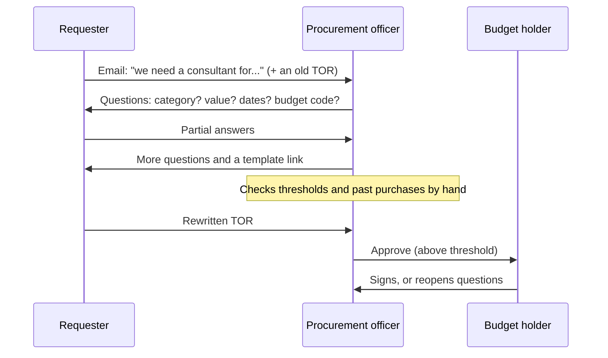
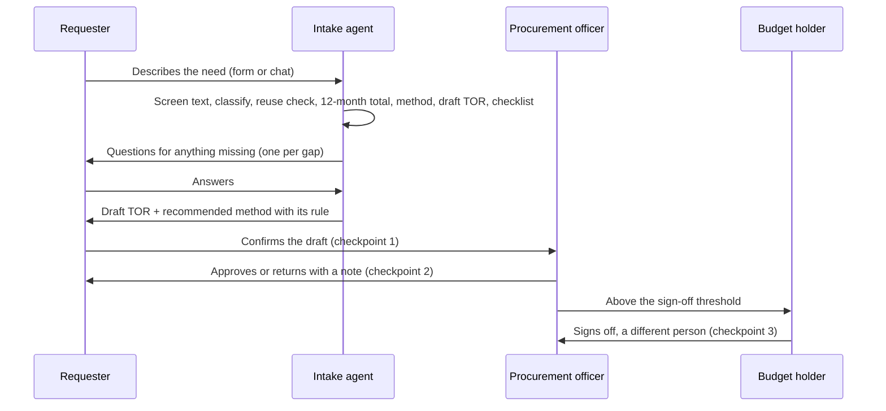

# 2. Service blueprint: the process before and after, step by step

Status: v0.1, October 2026. Owner: product owner.

The product is not "an AI assistant for procurement". It is a redesigned intake process in which
an agent does the preparation and people keep every decision. This page shows what changes, step
by step, and who acts at each step.

## As-is (hypothesis H1: two or more rounds of rework for most requests)

## To-be: the agent prepares, people decide

## Step by step: who acts, and how much the agent may do

Autonomy levels are defined in [06-human-control.md](06-human-control.md): **A0** person only,
**A1** agent suggests, **A2** agent drafts and a person confirms, **A3** agent acts and a person can
review.

| # | Step | As-is: who and how | To-be: who and how | Agent autonomy | Why that level |
|---|---|---|---|---|---|
| 1 | Describe the need | Requester, free email | Requester, guided questions | - | The need is the requester's |
| 2 | Screen the text | Nobody | Agent flags instruction-like text; the field is withheld | A3 | Protective only; it can block, never approve |
| 3 | Category | Officer, by asking | Agent proposes; requester confirms; ambiguous -> question | A2 | Wrong category = wrong queue and template |
| 4 | Reuse check (framework agreements) | Officer, from memory | Agent checks active frameworks, ceiling and scope | A1 | Coverage of scope is a judgment; officer confirms |
| 5 | 12-month total and split check | Officer, by hand, sometimes | Agent adds related requests; flags a split | A1 | Flag for a person; never an accusation |
| 6 | Method | Officer | Agent recommends with the rule, value and threshold | A1 | Method is a procurement decision |
| 7 | Sole-source justification | Officer asks late | Agent asks at intake when a supplier is named | A2 | Justification is the requester's to write |
| 8 | TOR | Requester rewrites old files | Agent drafts from template; unknowns marked | A2 | Requester owns the content and confirms it |
| 9 | Completeness | Officer discovers gaps | Agent checklist; each gap is a question | A3 | Mechanical; blocks, never approves |
| 10 | Route | Shared inbox | Agent routes by category and value | A3 | Reversible; officer can reassign |
| 11 | Confirm the draft | (implicit) | Requester, explicit checkpoint | A0 | Accountability for the request |
| 12 | Approve or return | Officer | Officer, with the package and audit trail | A0 | Procurement decision |
| 13 | Sign off spend | Budget holder | A different budget holder, above threshold | A0 | Four eyes on spend |

The line the agent never crosses: steps 11 to 13. The code enforces it
([workflow.py](../../src/intake_desk/workflow.py)), and a test tries every sequence of agent and
requester actions to prove it (`test_US09_no_command_sequence_lets_the_agent_or_requester_approve`).

## What is removed from the process, not just sped up

- **The question rounds.** Gaps are found at intake, as questions, before an officer sees the case.
- **Memory-dependent checks.** Split purchases and framework coverage are checked every time,
  against data, with the evidence shown.
- **Blank-page TORs.** Every request starts from the template with the requester's own answers.

## What stays deliberately manual

Approving, returning, signing off, choosing or contacting suppliers, and setting thresholds. The
reasons are in [06-human-control.md](06-human-control.md) and the decision log (D2, D4).
