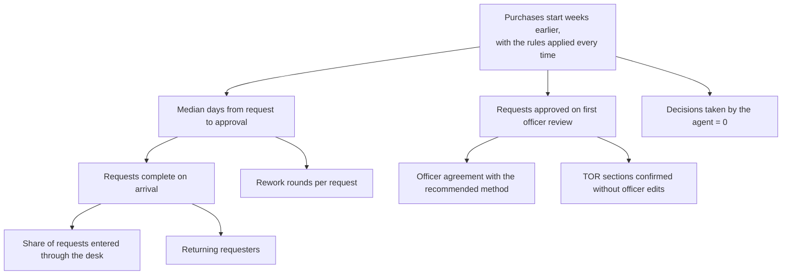

# 8. Value, metrics and the pilot

Status: v0.1, October 2026. Owner: product owner. Every target is fixed **before** the pilot
starts, so the go / no-go cannot be argued after the fact.

## 8.1 Metric tree

| Level | Metric | Definition | Source |
|---|---|---|---|
| North star | First-review approval | Approved cases with no return / all decided cases | Case history |
| Outcome | Cycle time | Median days, submission to final approval | Case history (US-16) |
| Outcome | Rework rounds | Needs-information cycles + returns, per case | Case history (US-16) |
| Leading | Complete on arrival | Cases reaching an officer with every required item met at first submission | Checklist at first run |
| Leading | Officer agreement | Approvals where the officer kept the recommended method / all approvals | Officer note |
| Guardrail | Agent decisions | Status changes by the agent role | Workflow log; CI test |
| Guardrail | Screening false positives | Blocking flags the officer judged harmless / all blocking flags | Officer review of flags |
| Adoption | Coverage and return use | See [07-adoption-and-change.md](07-adoption-and-change.md) 7.5 | Case files |

## 8.2 Pilot design

- **Units**: one pilot unit (desk) and one comparison unit of similar request volume (improved form
  and template only: the "stop" option). Both measured the same way.
- **Duration**: six weeks, preceded by a baseline of 30 historical requests per unit, coded for
  rounds of rework and days to approval.
- **Volume needed**: at least 25 requests in the pilot unit, or the pilot extends by three weeks.
- **Sampled review**: every second week, 10 cases re-checked by a senior officer against the policy
  by hand. Any wrong rule becomes a failing test before the fix.
- **Continuous discovery**: a weekly 30-minute touchpoint with two requesters and one officer,
  rotating, plus every return note and thumbs-down read the same week. Insights go to an
  opportunity list and become backlog items at refinement; the interview guide in
  [01-discovery.md](01-discovery.md) opens week 1.
- **Data**: case files and events only; pseudonymous ids; no content leaves the organisation.

## 8.3 How each hypothesis is decided

| Hypothesis | Measure | Go | Iterate | Kill |
|---|---|---|---|---|
| H1 Rework dominates | Baseline coding | over half need 2+ rounds | a third to a half | under a third |
| H2 Approvable on first review | First-review approval and cycle time vs comparison unit | 70%+, +30 points and -30% days | +15 to +30 points | under +15 points |
| H3 Officer trust | Agreement; type of disagreement | 90%+, disagreements are judgment | 80-90%, rule fixes ship | rule errors recur after a fix |
| H4 Control | Sign-off by head of procurement and audit; requesters can name who approved (week-6 check) | signed | signed with changes | not signed |
| H5 Return use | Requesters back unprompted | 60%+ | 40-60% | under 40% |

## 8.4 Decision rule at week 6

**Go** (scale to a second unit and start the channel work): H2 and H3 at Go, H4 signed.
**Iterate** (one more increment in the same unit): H2 at Iterate or better, H3 not at Kill.
**Stop**: any Kill, or H4 not signed. Keep the improved form and template; publish what was learned.

## 8.5 What v0.1 already measures, and what it does not

v0.1 emits usage events (confirmations and ratings) in the ai-adoption-tracker format and keeps a
full case history. Cycle time and rework rounds are computed from that history by US-16, the first
item of the next increment. Until then, any value figure is the illustrative model in
[03-options-and-investment-case.md](03-options-and-investment-case.md), labelled as such.
